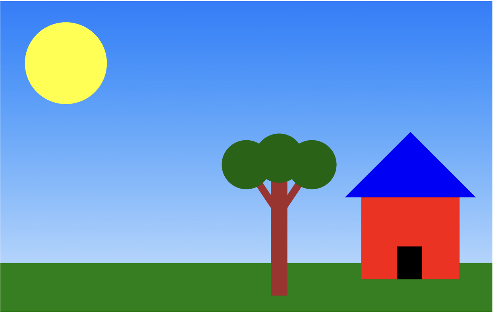
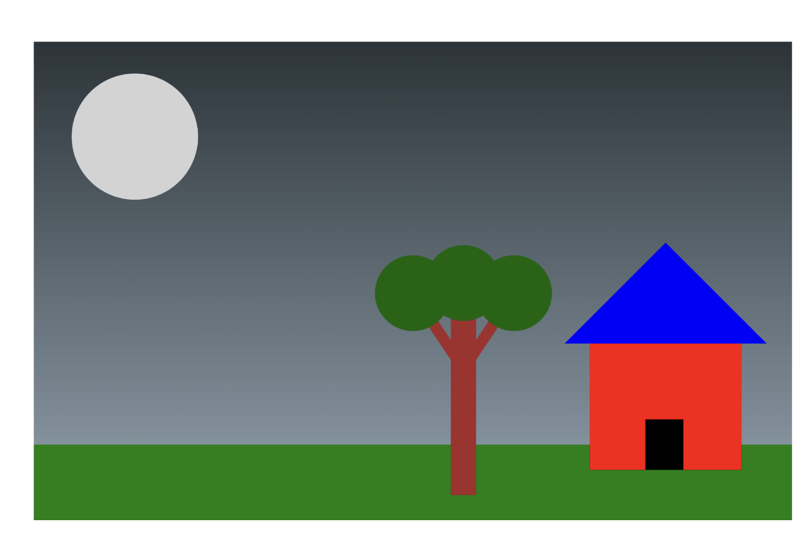

Garrett Campbell

Resources and Documentation that I used and referenced for this project:
1. https://developer.mozilla.org/en-US/docs/Web/SVG/Tutorials/SVG_from_scratch/Gradients
2. https://developer.mozilla.org/en-US/docs/Web/SVG/Reference/Element/stop
3. https://d3js.org/d3-transition/timing
4. https://developer.mozilla.org/en-US/docs/Web/SVG/Guides/Content_type
5. https://developer.mozilla.org/en-US/docs/Web/SVG/Tutorials/SVG_from_scratch/Basic_shapes
6. https://d3js.org/d3-transition
I created a simple landscape, with a house made up of rectangles, of different colors, and a polygon ontop as the roof. I also included a tree, using a rectangle as the trunk, lines used as branches, and circles used as leaves. My technical achievement was the implementation of a day/night cycle, which consisted of an animation for the sun to go to the bottom of the page, switch to white, and go back up to the top, combined with a gradient background that changed colors depending on whether the sun was in the sky or the moon was. 

## Screenshots

